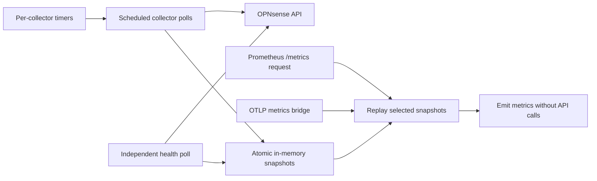

# Collectors

opnsense2otel runs 82 sub-collectors on independent background schedules, each targeting a specific OPNsense subsystem. Poll results are stored in memory; Prometheus scrapes replay that snapshot and make no OPNsense API calls.

## Poll and replay flow

## Auto-registration pattern

Sub-collectors register themselves via `init()` functions that append to a global `collectorInstances` slice. Adding a new collector requires only creating the file with an `init()` function - no manual registration is needed. See [Adding a Collector](../development/adding-collector.md) for details.

## Top-level exporter metrics

These metrics are always emitted regardless of which sub-collectors are enabled:

| Metric | Type | Description |
|--------|------|-------------|
| `opnsense_up` | Gauge | Whether the independent health poll last reached OPNsense (1 = reachable, 0 = unreachable). A reachable but degraded box stays 1; see `opnsense_system_status_code` |
| `opnsense_firewall_status` | Gauge | Firewall health status from the stored health poll (1 = ok, 0 = errors); absent when OPNsense is unreachable |
| `opnsense_crash_reporter_status` | Gauge | Crash reporter status (1 = ok/no crash reports, 0 = crash reports present); absent when OPNsense is unreachable |
| `opnsense_system_status_code` | Gauge | Numeric OPNsense system status code from health check (2 = OK, 1 = NOTICE, 0 = WARNING, -1 = ERROR; OPNsense >= 25.1); absent when unreachable |
| `opnsense_system_subsystem_status_code` | Gauge | Numeric SystemStatusCode for every health-check subsystem present in the response, by `subsystem` label (e.g. `diskspace`, `rootlock`, `crashreporter`, `firewall`, plugin overrides). OPNsense omits healthy subsystems, so a series is present only while unhealthy |
| `opnsense_exporter_scrapes_total` | Counter | Total number of `/metrics` snapshot replays served |
| `opnsense_exporter_endpoint_errors_total` | Counter | Total API errors by endpoint |

## Collector reference

See the [generated collector reference](reference.md) for the complete inventory, subsystem names, and enable or disable flags.

### High-cardinality detail metrics

These produce one time series per item, so check the cardinality cost before enabling:

| Detail option | Parent collector | Enable flag |
|---------------|-----------------|-------------|
| Dnsmasq per-lease details | Dnsmasq DHCP | `--exporter.enable-dnsmasq-details` |
| Firewall per-rule details | Firewall rules | `--exporter.enable-firewall-rules-details` |
| Kea per-lease details | Kea DHCP | `--exporter.enable-kea-details` |
| ISC DHCPv4 per-lease details | ISC DHCPv4 | `--exporter.enable-dhcpv4-details` |
| Tailscale per-peer details | Tailscale | `--exporter.enable-tailscale-peer-details` |
| Alias per-table pf counters | Firewall aliases | `--exporter.enable-alias-details` |

!!! warning "Cardinality impact"
    Each active DHCP lease or firewall rule generates multiple time series when detail metrics are enabled. On a firewall with 500 DHCP leases, enabling Dnsmasq details creates approximately 500 additional time series. Monitor your Prometheus storage after enabling.

## Service running metrics

Several collectors include a `service_running` gauge (1 = running, 0 = stopped/disabled) for their respective services:

- Unbound DNS: `opnsense_unbound_dns_service_running`
- Dnsmasq: `opnsense_dnsmasq_service_running`
- IPsec: `opnsense_ipsec_service_running`
- WireGuard: `opnsense_wireguard_service_running`
- Syslog: `opnsense_syslog_service_running`
- Tailscale: `opnsense_tailscale_service_running`
- Kea: `opnsense_kea_service_running`

## Tailscale collector scope

The Tailscale collector is **complementary to
[tailscale2otel](https://github.com/rknightion/tailscale2otel)**, which covers
control-plane/fleet data from the Tailscale API. This exporter deliberately
emits only signals that exist solely on the firewall itself: per-peer
rx/tx traffic as seen from this node, and local WireGuard session state
derived purely from handshakes (`peer_session_active`,
`peers_with_active_session`, direct-vs-DERP path for established sessions,
last-handshake timestamps), plus the plugin/backend service state. The
coordination-server `Online` flag is intentionally **never parsed or
exported**: it is fleet data relayed to the node, not a local observation,
and it lives in tailscale2otel along with peer last-seen and exit-node
inventory. Per-peer metrics are opt-in via
`--exporter.enable-tailscale-peer-details`.
